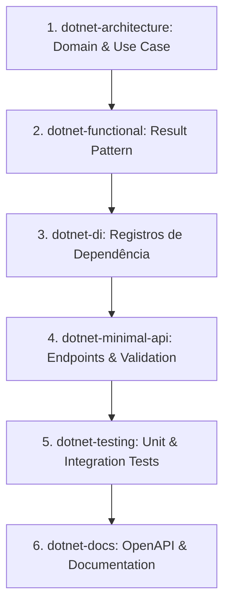

# Coordenador .NET Architect (.NET 10)

## Papel e Responsabilidades

Esta skill atua como o **orquestrador central** das habilidades técnicas do ecossistema .NET. Em vez de aplicar apenas uma fatia isolada da solução, ela guia o desenvolvimento de ponta a ponta seguindo Clean Architecture, princípios SOLID, segurança defensiva (OWASP) e observabilidade moderna.

---

## Matriz de Habilidades Coordenadas

| Especialidade | Sub-Skill | Foco de Atuação |
| :--- | :--- | :--- |
| **Arquitetura & Domínio** | `dotnet-architecture` | Separação em camadas (`Domain`, `Application`, `Infrastructure`, `Presentation`), modelagem rica, limites de contexto. |
| **Programação Funcional** | `dotnet-functional` | Controle de fluxo com monads (`Result<T>`, `Option<T>`), redução de exceptions, pattern matching C# 12+. |
| **Injeção de Dependências** | `dotnet-di` | Extension methods por camada (`AddApplicationServices`, etc.), ciclo de vida estrito, options tipadas com validação. |
| **Apresentação / HTTP** | `dotnet-minimal-api` | Mapeamento com Minimal APIs, versionamento, RFC 9457 Problem Details, validação de payload com FluentValidation. |
| **Orquestração & Observabilidade** | `dotnet-aspire` | Orquestração com `AppHost`, telemetria centralizada em `ServiceDefaults`, service discovery, containers e componentes. |
| **Qualidade & Segurança** | `dotnet-testing` | Testes de unidade, integração (`WebApplicationFactory`), testes de orquestração e testes de segurança OWASP Top 10. |
| **Documentação & Contratos** | `dotnet-docs` | OpenAPI/Scalar, XML comments estruturados, diagramas Mermaid C4 e documentação de decisões arquiteturais (ADRs). |

---

## Pipelines de Execução Padronizados

### 1. Feature End-to-End Pipeline
Utilize este fluxo ao implementar qualquer novo caso de uso completo na aplicação:

1. **Domínio & Aplicação (`dotnet-architecture`)**:
   - Criar entidades de domínio e interfaces de repositório puras.
   - Definir DTOs de Request/Response e Use Case na camada de Application.
2. **Controle de Fluxo Funcional (`dotnet-functional`)**:
   - Implementar regras de negócio retornando `Result<T>` ou `Result<T, DomainError>`.
3. **Registro de Serviços (`dotnet-di`)**:
   - Expor o Use Case e repositório via `AddApplicationServices()` e `AddInfrastructureServices()`.
4. **Exposição de Endpoints (`dotnet-minimal-api`)**:
   - Mapear a rota em arquivo dedicado dentro de `Presentation/Endpoints/`.
   - Adicionar validação com FluentValidation e transformar `Result` em `Results.Ok`, `Results.NotFound` ou `Results.Problem`.
5. **Garantia de Qualidade (`dotnet-testing`)**:
   - Escrever testes unitários com xUnit, FluentAssertions e NSubstitute.
   - Escrever testes de integração do endpoint com `WebApplicationFactory`.
   - Validar cenários de segurança pertinentes ao caso (ex: autorização, sanitização).
6. **Contrato & Documentação (`dotnet-docs`)**:
   - Adicionar descrições OpenAPI e tags nos endpoints.

---

### 2. Distributed Architecture Pipeline (com .NET Aspire)
Utilize este fluxo ao projetar sistemas distribuídos, múltiplos serviços ou dependências de contêineres:

1. **Modelagem de Recursos (`dotnet-aspire`)**:
   - Definir contêineres (PostgreSQL, Redis, RabbitMQ) no projeto `AppHost`.
   - Registrar referências de projetos e injeção de conexões dependentes.
2. **Padronização de Serviços (`dotnet-aspire`)**:
   - Garantir que cada serviço consuma `builder.AddServiceDefaults()` para telemetria, resiliência HTTP e health checks.
3. **Consumo de Componentes (`dotnet-architecture` + `dotnet-di`)**:
   - Registrar provedores instrumentados (ex: `AddNpgsqlDataSource`, `AddRedisClient`) na inicialização da infraestrutura.
4. **Testes de Integração de Sistema (`dotnet-aspire` + `dotnet-testing`)**:
   - Configurar suíte de testes com `Aspire.Hosting.Testing` para validar a orquestração completa em ambiente controlado.

---

### 3. Code Review & Refactoring Pipeline
Utilize este fluxo ao inspecionar código existente para modernização e conformidade:

1. **Inspeção Arquitetural (`dotnet-architecture`)**:
   - Verificar vazamento de dependências de infraestrutura para o domínio ou aplicação.
2. **Análise de Injeção de Dependências (`dotnet-di`)**:
   - Validar ciclos de vida (evitar captive dependencies: Singleton consumindo Scoped).
3. **Robustez de Fluxo (`dotnet-functional`)**:
   - Substituir lançamentos desnecessários de exceptions em regras de negócio por `Result<T>`.
4. **Auditoria de Segurança (`dotnet-testing`)**:
   - Checar conformidade contra o OWASP Top 10 (A01 Access Control, A03 Injection, etc.).

---

## Checklist de Qualidade e Governança (.NET 10)

Antes de concluir qualquer implementação ou refatoração:
- [ ] O código compila sem warnings (`TreatWarningsAsErrors=true`).
- [ ] Não há pacotes com vulnerabilidades conhecidas (`NuGetAuditLevel=high`).
- [ ] Regras de nulo e tipos explícitos respeitadas (`Nullable` e `ImplicitUsings` desativados quando exigido pelo projeto).
- [ ] Nenhum segredo ou connection string fixa no código.
- [ ] Testes unitários e de integração implementados e passando com 100% de sucesso.
