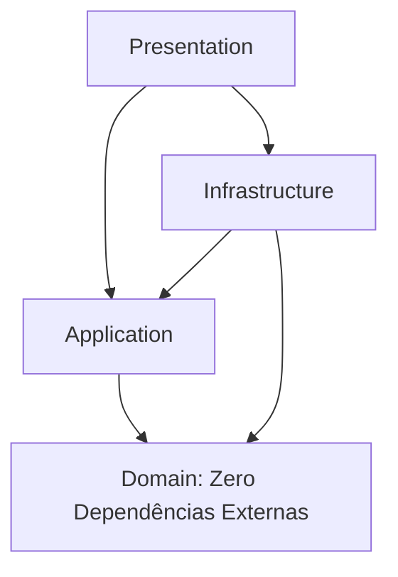

# Configurações de Compilação Estrita e Projetos (.csproj)

Esta referência define o modelo corporativo de governança de compilação em .NET 10, garantindo isolamento estrito de dependências entre as camadas da Clean Architecture e compliance com `Directory.Build.props`.

---

## 1. Directory.Build.props (Raiz da Solução)

Padroniza regras estritas de qualidade, avisos como erros e análise avançada de código em todos os projetos da solução:

```xml
<Project>
  <PropertyGroup>
    <TargetFramework>net10.0</TargetFramework>
    <LangVersion>latest</LangVersion>
    <ImplicitUsings>disable</ImplicitUsings>
    <Nullable>disable</Nullable>
    <TreatWarningsAsErrors>true</TreatWarningsAsErrors>
    <AnalysisMode>All</AnalysisMode>
    <EnforceCodeStyleInBuild>true</EnforceCodeStyleInBuild>
    <NuGetAudit>true</NuGetAudit>
    <NuGetAuditLevel>high</NuGetAuditLevel>
    <WarningsAsErrors>$(WarningsAsErrors);NU1901;NU1902;NU1903;NU1904</WarningsAsErrors>
  </PropertyGroup>
</Project>
```

---

## 2. Matriz de Dependência entre Camadas



---

## 3. Templates de `.csproj` por Camada

### 3.1 Domain (`src/Domain/Domain.csproj`)
O Domínio nunca referencia pacotes externos de ORM, banco ou frameworks web.

```xml
<Project Sdk="Microsoft.NET.Sdk">
  <PropertyGroup>
    <RootNamespace>Domain</RootNamespace>
    <AssemblyName>Domain</AssemblyName>
  </PropertyGroup>
</Project>
```

### 3.2 Application (`src/Application/Application.csproj`)
A camada de Aplicação referencia apenas o Domínio e pacotes utilitários de validação ou orquestração em memória (ex.: FluentValidation). Nunca referencia pacotes de banco de dados diretamente.

```xml
<Project Sdk="Microsoft.NET.Sdk">
  <PropertyGroup>
    <RootNamespace>Application</RootNamespace>
    <AssemblyName>Application</AssemblyName>
  </PropertyGroup>

  <ItemGroup>
    <ProjectReference Include="..\Domain\Domain.csproj" />
  </ItemGroup>

  <ItemGroup>
    <PackageReference Include="FluentValidation" Version="11.*" />
    <PackageReference Include="Microsoft.Extensions.DependencyInjection.Abstractions" Version="10.*" />
  </ItemGroup>
</Project>
```

### 3.3 Infrastructure (`src/Infrastructure/Infrastructure.csproj`)
A Infraestrutura implementa as interfaces do Domínio e da Aplicação utilizando tecnologias concretas (Dapper, Npgsql, etc.).

```xml
<Project Sdk="Microsoft.NET.Sdk">
  <PropertyGroup>
    <RootNamespace>Infrastructure</RootNamespace>
    <AssemblyName>Infrastructure</AssemblyName>
  </PropertyGroup>

  <ItemGroup>
    <ProjectReference Include="..\Domain\Domain.csproj" />
    <ProjectReference Include="..\Application\Application.csproj" />
  </ItemGroup>

  <ItemGroup>
    <PackageReference Include="Dapper" Version="2.*" />
    <PackageReference Include="Npgsql" Version="9.*" />
    <PackageReference Include="Microsoft.Extensions.Options.ConfigurationExtensions" Version="10.*" />
    <PackageReference Include="Microsoft.AspNetCore.Identity" Version="2.*" />
  </ItemGroup>
</Project>
```

### 3.4 Presentation (`src/Presentation/Presentation.csproj`)
Ponto de entrada (Web API) que monta o container de DI e expõe os endpoints HTTP Minimal API.

```xml
<Project Sdk="Microsoft.NET.Sdk.Web">
  <PropertyGroup>
    <RootNamespace>Presentation</RootNamespace>
    <AssemblyName>Presentation</AssemblyName>
  </PropertyGroup>

  <ItemGroup>
    <ProjectReference Include="..\Application\Application.csproj" />
    <ProjectReference Include="..\Infrastructure\Infrastructure.csproj" />
  </ItemGroup>

  <ItemGroup>
    <PackageReference Include="Microsoft.AspNetCore.OpenApi" Version="10.*" />
    <PackageReference Include="Scalar.AspNetCore" Version="2.*" />
  </ItemGroup>
</Project>
```
