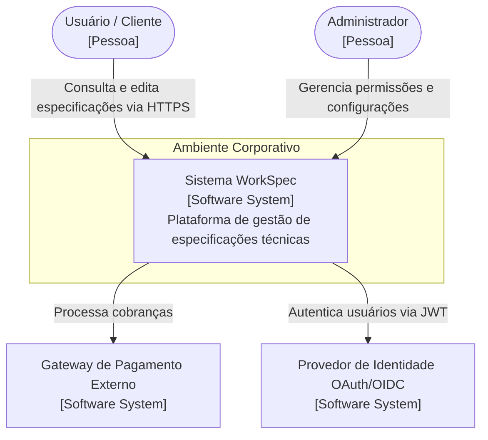
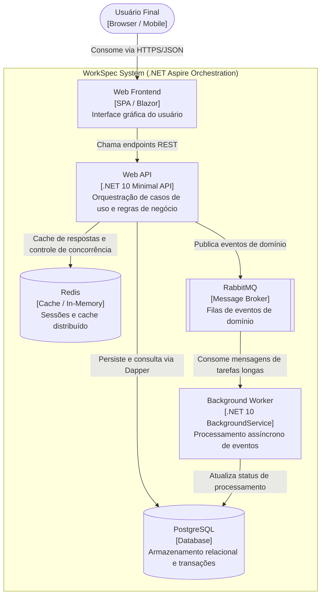

# Diretrizes de Diagramas C4 com Mermaid

Esta referência padroniza a criação de diagramas arquiteturais no modelo C4 (Contexto e Contêiner) utilizando sintaxe Mermaid nativa suportada pelo GitHub e documentação técnica em Markdown.

---

## 1. Regras de Sintaxe e Renderização Segura
- **Evite tags HTML dentro de rótulos**: Tags como ` ` ou `<b>` podem quebrar renderizadores estritos. Prefira quebras de linha normais com aspas duplas: `["Texto da Linha 1\nTexto da Linha 2"]`.
- **Sempre utilize aspas duplas** em rótulos contendo parênteses, colchetes, dois-pontos ou caracteres especiais. Exemplo: `api["API de Pagamentos (.NET 10)"]`.
- **Utilize subgrafos (`subgraph`)** para delimitar limites de sistema e limites corporativos.

---

## 2. Nível 1: Diagrama de Contexto de Sistema (System Context)

Mostra os usuários, sistemas externos e o sistema em questão:

---

## 3. Nível 2: Diagrama de Contêineres (Container Diagram)

Exibe as aplicações executáveis, bancos de dados, filas e serviços que compõem o sistema com base na topologia .NET Aspire:

